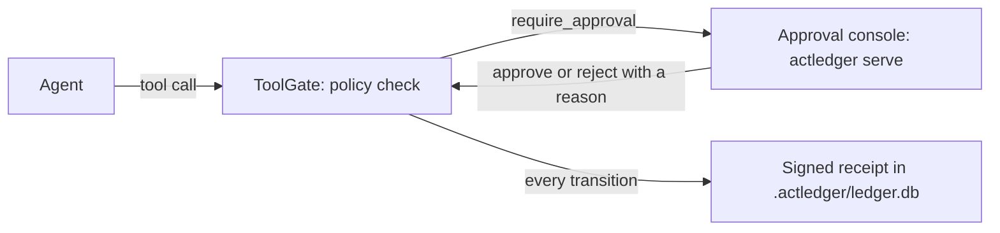

[English](README.md) | [简体中文](README.zh-CN.md)

# ActLedger

ActLedger checks an agent's tool call against a policy, holds it for a person to approve before the tool runs, and writes every step as a signed receipt in a local ledger that `actledger verify` checks offline.

## Try it

0.1.0 is not published yet. From a clone, with Node.js 22.13+ and pnpm 9:

```bash
git clone https://github.com/GEON-tt/ActLedger.git
cd ActLedger
corepack enable
pnpm install && pnpm build && pnpm demo
```

The terminal prints the approval console URL with its login link and the chat URL, and opens both in the browser. The default model is the built-in fake model, so no API key is needed. Type `send: standup moved to 3pm`: `send_note` waits until you approve it in the console, then the chat shows the task id, the approver, the receipt hash, and the verify result. `list` runs without approval.

`ACTLEDGER_DEMO_PROVIDER=cursor|claude|openai` switches to a real model (`CURSOR_API_KEY`, `ANTHROPIC_API_KEY`, or `OPENAI_API_KEY`). See [examples/chat-approval](examples/chat-approval).

## How a call flows



## Pick your scenario

- [Your own agent loop](docs/en/scenarios/own-loop.md): call ToolGate before and after each tool.
- [Cursor SDK](docs/en/scenarios/cursor-sdk.md): gate `customTools` for a `grok-4.7` agent.
- [Claude Agent SDK](docs/en/scenarios/claude-agent-sdk.md): `canUseTool` and `PostToolUse` on a ToolGate.
- [OpenAI Agents SDK](docs/en/scenarios/openai-agents.md): `needsApproval` interruptions on a ToolGate.
- [An MCP server](docs/en/scenarios/mcp-server.md): put the MCP proxy in front of it; this is the enforced path.
- [The approval console](docs/en/scenarios/approval-console.md): log in, log in again, rotate the token, and why Approve can be disabled.

## Recorded or enforced

ToolGate and the two adapters run inside the agent process. They are recorded: the model can still reach the same service through a shell, an HTTP client, or a browser. The MCP proxy holds the only connection to the upstream server, so calls to the tools it exposes are enforced. See [guarantees](docs/en/guarantees.md).

## Docs

[Getting started](docs/en/getting-started.md) · [Approval](docs/en/approval.md) · [Guarantees](docs/en/guarantees.md) · [Integrations](docs/en/integrations.md) · [Tool gate](docs/en/tool-gate.md) · [MCP proxy](docs/en/mcp-proxy.md) · [TypeScript SDK](docs/en/sdk-typescript.md) · [Python SDK](docs/en/sdk-python.md) · [Architecture and packages](docs/en/architecture.md) · [Specification](spec/README.md)

Contributing, tests, and builds: [CONTRIBUTING.md](CONTRIBUTING.md). Security: [SECURITY.md](SECURITY.md). [Code of conduct](CODE_OF_CONDUCT.md).

## Community plugins

No community plugins are listed yet. Open a pull request to add one.

## License

Apache-2.0. See [LICENSE](LICENSE).
