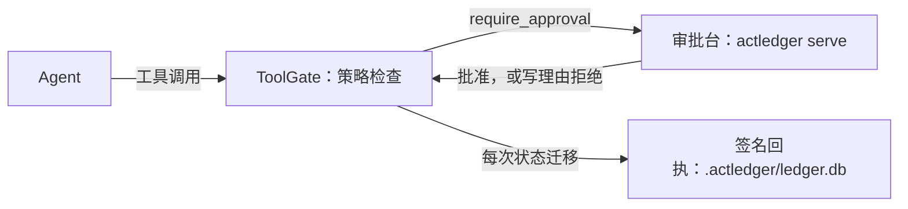

[English](README.md) | [简体中文](README.zh-CN.md)

# ActLedger

ActLedger 先按策略检查 agent 的工具调用，在工具运行前交给人批准，并把每一步写成本地账本里的签名回执，`actledger verify` 可以离线校验。

## 试一下

0.1.0 还没有发布。从克隆运行，需要 Node.js 22.13+ 和 pnpm 9：

```bash
git clone https://github.com/GEON-tt/ActLedger.git
cd ActLedger
corepack enable
pnpm install && pnpm build && pnpm demo
```

终端会打印审批台 URL 和它的登录链接，以及聊天页 URL，并在浏览器里打开这两个页面。默认模型是内置的 fake 模型，不需要 API key。输入「帮我发一条笔记：明天下午三点开会」后，`send_note` 会等到你在审批台批准，然后聊天页显示任务 id、审批人、回执哈希和校验结果。「列出笔记」不需要批准就会运行。

`ACTLEDGER_DEMO_PROVIDER=cursor|claude|openai` 切换到真实模型（`CURSOR_API_KEY`、`ANTHROPIC_API_KEY` 或 `OPENAI_API_KEY`）。见 [examples/chat-approval](examples/chat-approval)。

## 一次调用怎么走



## 选你的场景

- [你自己的 agent 循环](docs/zh-CN/scenarios/own-loop.md)：每次工具调用前后调用 ToolGate。
- [Cursor SDK](docs/zh-CN/scenarios/cursor-sdk.md)：给 `grok-4.7` agent 的 `customTools` 加上闸门。
- [Claude Agent SDK](docs/zh-CN/scenarios/claude-agent-sdk.md)：在 ToolGate 上挂 `canUseTool` 和 `PostToolUse`。
- [OpenAI Agents SDK](docs/zh-CN/scenarios/openai-agents.md)：在 ToolGate 上处理 `needsApproval` 中断。
- [一个 MCP 服务器](docs/zh-CN/scenarios/mcp-server.md)：把 MCP 代理放在它前面；这是强制路径。
- [审批台](docs/zh-CN/scenarios/approval-console.md)：登录、再次登录、轮换 token，以及为什么 Approve 会被禁用。
- [远端服务器](docs/zh-CN/scenarios/remote-server.md)：账本和签名私钥留在你运行的服务器上。部署：[deploy/README.zh-CN.md](deploy/README.zh-CN.md)。

## 记录式还是强制式

ToolGate 和两个适配器跑在 agent 进程里面。它们是记录式：模型仍然可以通过 shell、HTTP 客户端或浏览器访问同一个服务。MCP 代理持有到上游服务器的唯一连接，所以它暴露出来的工具调用是强制式。见[保证边界](docs/zh-CN/guarantees.md)。

## 文档

[入门](docs/zh-CN/getting-started.md) · [审批](docs/zh-CN/approval.md) · [保证边界](docs/zh-CN/guarantees.md) · [框架集成](docs/zh-CN/integrations.md) · [工具闸门](docs/zh-CN/tool-gate.md) · [MCP 代理](docs/zh-CN/mcp-proxy.md) · [TypeScript SDK](docs/zh-CN/sdk-typescript.md) · [Python SDK](docs/zh-CN/sdk-python.md) · [架构与包](docs/zh-CN/architecture.md) · [规范](spec/zh-CN/README.md)

参与贡献、测试和构建见 [CONTRIBUTING.zh-CN.md](CONTRIBUTING.zh-CN.md)。安全问题见 [SECURITY.zh-CN.md](SECURITY.zh-CN.md)。[行为准则](CODE_OF_CONDUCT.md)。

## 社区插件

还没有收录的社区插件。通过 PR 申请加入这份列表。

## License

Apache-2.0。见 [LICENSE](LICENSE)。
