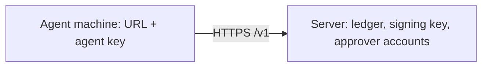

[English](README.md) | [简体中文](README.zh-CN.md)

# Deploy ActLedger

One server holds the ledger, the signing key, and the approver accounts. Each agent machine has only `ACTLEDGER_URL` and an agent key.

## What you get



Agents submit and execute. People approve in the browser. The HTTP API is [spec/http.md](../spec/http.md).

## Before you start

You need a machine with a public IP, a DNS A or AAAA record pointing at it, ports 80 and 443 open, and Docker with Compose v2.

## Initialize

```bash
cp deploy/.env.example deploy/.env
```

Set `DOMAIN` to the name that points at this machine. Write a policy before the first task. Rules the console should approve need `min_assurance: app_asserted`. In the default policy, `send`, `spend`, and `delete` rise to `channel_verified` when a rule sets no minimum, and the console cannot record that approval.

```bash
docker compose -f deploy/docker-compose.yml run --rm \
  -v "$PWD/policy.yaml:/policy.yaml:ro" \
  server init --policy /policy.yaml
```

## Start

```bash
docker compose -f deploy/docker-compose.yml up -d --build
curl "https://$DOMAIN/healthz"
```

Caddy requests a certificate for `$DOMAIN` and proxies to the server. The server listens on the compose network only. It is not published on a host port.

## Add an approver

```bash
docker compose -f deploy/docker-compose.yml exec server \
  actledger-server user add alice --principal u_1
```

Type the password when asked and scan the QR code with an authenticator app. Later: `user reset-totp <username>` and `user list`.

## Create an agent key

```bash
docker compose -f deploy/docker-compose.yml exec server \
  actledger-server agent-key create --agent my-agent --principal u_1
```

On the agent machine:

```bash
export ACTLEDGER_URL="https://$DOMAIN"
export ACTLEDGER_API_KEY="alk_..."
```

The `--agent` value has to match `agentId` in the agent code. `agent-key list` and `agent-key revoke <id>` manage keys. `audit-key create` makes a read-only key for someone who exports and verifies the chain.

## First approval

```ts
import { Ledger } from "@actledger/sdk";
const ledger = new Ledger({ mode: "remote" });
```

```python
from actledger import Ledger
ledger = Ledger(mode="remote")
```

Open `https://$DOMAIN/`, sign in, and approve. The chat demo can use the same URL and key. See [examples/chat-approval](../examples/chat-approval/README.md).

## Backup

The volume holds `ledger/` (`keys/ed25519.pem`, `keys/master.key`, `ledger.db`) and `server.db`. Stop the server, then archive the volume. The archive is the signing key. Encrypt it.

```bash
docker compose -f deploy/docker-compose.yml stop server
docker run --rm -v deploy_actledger-data:/data -v "$PWD":/backup busybox \
  tar czf /backup/actledger-$(date +%F).tgz -C /data .
```

Restore by extracting that archive back onto an empty volume, then `up -d`. The volume name is `<compose project>_actledger-data`. From this repository the project directory is `deploy`, so the volume is `deploy_actledger-data`.

## Upgrade

```bash
git pull && docker compose -f deploy/docker-compose.yml up -d --build
```

The data volume is not replaced. Take a backup first.

## Limits

What a remote server does and does not prove is in [Three deployments](../docs/en/guarantees.md#three-deployments).
