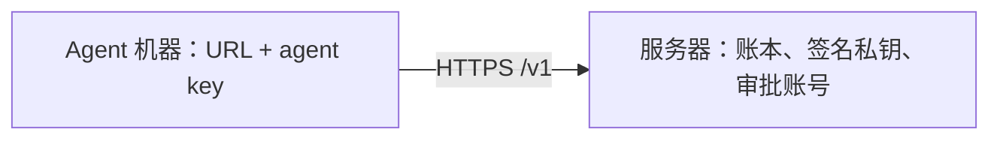

[English](README.md) | [简体中文](README.zh-CN.md)

# 部署 ActLedger

一台服务器放账本、签名私钥和审批账号。每台 agent 机器只有 `ACTLEDGER_URL` 和一把 agent key。

## 你得到什么



agent 提交并执行。人在浏览器里批准。HTTP API 见 [spec/zh-CN/http.md](../spec/zh-CN/http.md)。

## 开始之前

需要一台有公网 IP 的机器、指向它的域名 A 或 AAAA 记录、放行 80 和 443，以及 Docker 和 Compose v2。

## 初始化

```bash
cp deploy/.env.example deploy/.env
```

把 `DOMAIN` 改成指向这台机器的域名。第一笔任务之前写好策略。审批台要能批的规则需要 `min_assurance: app_asserted`。默认策略里，规则没写最低保证时，`send`、`spend`、`delete` 会抬到 `channel_verified`，审批台记录不了。

```bash
docker compose -f deploy/docker-compose.yml run --rm \
  -v "$PWD/policy.yaml:/policy.yaml:ro" \
  server init --policy /policy.yaml
```

## 启动

```bash
docker compose -f deploy/docker-compose.yml up -d --build
curl "https://$DOMAIN/healthz"
```

Caddy 为 `$DOMAIN` 申请证书，并反向代理到服务器。服务器只在 compose 网络里监听，不映射到宿主机端口。

## 添加审批人

```bash
docker compose -f deploy/docker-compose.yml exec server \
  actledger-server user add alice --principal u_1
```

按提示输入密码，用验证器应用扫二维码。之后可以用 `user reset-totp <username>` 和 `user list`。

## 创建 agent key

```bash
docker compose -f deploy/docker-compose.yml exec server \
  actledger-server agent-key create --agent my-agent --principal u_1
```

在 agent 机器上：

```bash
export ACTLEDGER_URL="https://$DOMAIN"
export ACTLEDGER_API_KEY="alk_..."
```

`--agent` 必须和代码里的 `agentId` 一致。`agent-key list` 和 `agent-key revoke <id>` 管理 key。`audit-key create` 给需要导出并校验整条链的人一把只读 key。

## 第一次批准

```ts
import { Ledger } from "@actledger/sdk";
const ledger = new Ledger({ mode: "remote" });
```

```python
from actledger import Ledger
ledger = Ledger(mode="remote")
```

打开 `https://$DOMAIN/`，登录并批准。对话 demo 可以用同一个 URL 和 key。见 [examples/chat-approval](../examples/chat-approval/README.zh-CN.md)。

## 备份

卷里有 `ledger/`（`keys/ed25519.pem`、`keys/master.key`、`ledger.db`）和 `server.db`。先停服务器，再打包卷。这份备份等同私钥，加密保存。

```bash
docker compose -f deploy/docker-compose.yml stop server
docker run --rm -v deploy_actledger-data:/data -v "$PWD":/backup busybox \
  tar czf /backup/actledger-$(date +%F).tgz -C /data .
```

恢复是把归档解压回一个空卷，然后 `up -d`。卷名是 `<compose 项目名>_actledger-data`。在本仓库里项目目录是 `deploy`，所以卷名是 `deploy_actledger-data`。

## 升级

```bash
git pull && docker compose -f deploy/docker-compose.yml up -d --build
```

数据卷不会被换掉。升级前先备份。

## 边界

远端服务器能证明什么、不能证明什么，见[三种部署](../docs/zh-CN/guarantees.md#三种部署)。
