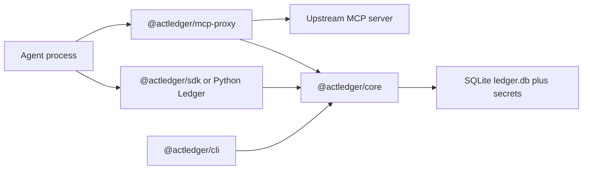

[English](architecture.md) | [简体中文](../zh-CN/architecture.md)

# Architecture

0.1.0 is a local ledger. There is no multi-tenant HTTP server, PostgreSQL, approval channel, or external timestamp anchor. Those stay behind `Store` on the engine and `Transport` on the SDK.

`@actledger/core` owns canonical JSON, commitments, Ed25519 receipts, the 11-state machine, YAML policy, and the SQLite store. Receipts are append-only. The Python package checks the same vectors and, for local calls, speaks [`actledger rpc`](../../spec/rpc.md) to this engine instead of reimplementing it.

## State machine, in short

`request` enters at `prepared`, then the first matching policy rule moves the task:

- `allow` → `approved` (approver `policy:<rule id>`)
- `require_approval` → `pending_approval`
- `deny` → `rejected`
- `draft_only` → `drafted`

A user approval moves `pending_approval` to `approved`. `claim` is the only way into `executing`, and it works once. `complete` or `fail` leaves `executing`. If the deadline passes first, the state is `unknown`, which must be reconciled rather than retried as if nothing ran. Terminal states are `executed`, `failed`, `rejected`, `drafted`, `expired`, and `revoked`.

The full table is [spec/state-machine.md](../../spec/state-machine.md) and [spec/transitions.json](../../spec/transitions.json).

## Where the check sits

Recorded mode wraps a tool inside the agent. The [MCP proxy](mcp-proxy.md) is enforced mode for the upstream it fronts: it claims the task before it forwards `tools/call`, and it declares `coverage` `enforced` for those tools. Approval still happens outside the agent, today via the CLI.

Policy evaluation is first-match. Unknown actions use `defaults.unknown_action`. Assurance ranks are `policy`, then `app_asserted`, `channel_verified`, and `user_signed`. Details: [spec/policy.md](../../spec/policy.md).

## What verify checks

`actledger verify` recomputes the receipt hash, checks the Ed25519 signature against `keys.json`, walks the chain from the genesis hash, and rebuilds each task's transitions. With a secrets file it recomputes commitments. It does not contact a server. See [guarantees.md](guarantees.md) for what that does not prove.
