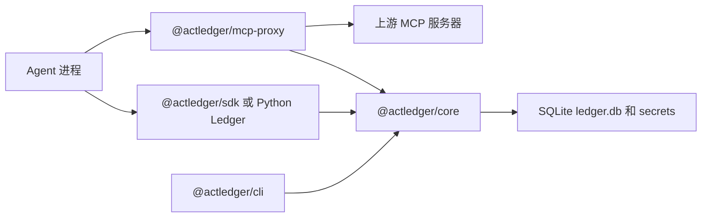

[English](../en/architecture.md) | [简体中文](architecture.md)

# 架构

0.1.0 是本地账本。没有多租户 HTTP 服务、PostgreSQL，也没有外部时间戳锚定。审批渠道仅本地 `actledger serve`（127.0.0.1）。托管能力以后走引擎的 `Store` 和 SDK 的 `Transport`。

`@actledger/core` 负责规范化 JSON、承诺、Ed25519 回执、11 个状态的状态机、YAML 策略和 SQLite 存储。回执只追加。Python 包用同一套测试向量做校验；本地调用时它通过 [`actledger rpc`](../../spec/zh-CN/rpc.md) 使用这个引擎，而不是再实现一遍。

## 状态机概要

`request` 从 `prepared` 进入，然后第一条命中的策略规则把任务送走：

- `allow` → `approved`（批准人是 `policy:<rule id>`）
- `require_approval` → `pending_approval`
- `deny` → `rejected`
- `draft_only` → `drafted`

用户批准把 `pending_approval` 送到 `approved`。只有 `claim` 能进入 `executing`，而且只能成功一次。`complete` 或 `fail` 离开 `executing`。如果期限先到，状态是 `unknown`，必须对账，不能当成没执行过再试一次。终态是 `executed`、`failed`、`rejected`、`drafted`、`expired`、`revoked`。

完整表在 [spec/zh-CN/state-machine.md](../../spec/zh-CN/state-machine.md) 和 [spec/transitions.json](../../spec/transitions.json)。

## 检查放在哪里

记录式在 agent 里面包住工具。[MCP 代理](mcp-proxy.md) 对它前面的上游是强制式：转发 `tools/call` 之前先 claim，并把这些工具的 `coverage` 声明为 `enforced`。批准仍然发生在 agent 外面，目前通过 CLI。

策略求值是第一条命中。未知动作走 `defaults.unknown_action`。保证等级从低到高是 `policy`、`app_asserted`、`channel_verified`、`user_signed`。细节见 [spec/zh-CN/policy.md](../../spec/zh-CN/policy.md)。

## verify 检查什么

`actledger verify` 重算回执哈希，用 `keys.json` 检查 Ed25519 签名，从创世哈希走完整条链，并重建每个任务的迁移。提供 secrets 文件时，它重算承诺。它不连接服务器。这不能证明什么，见 [guarantees.md](guarantees.md)。
